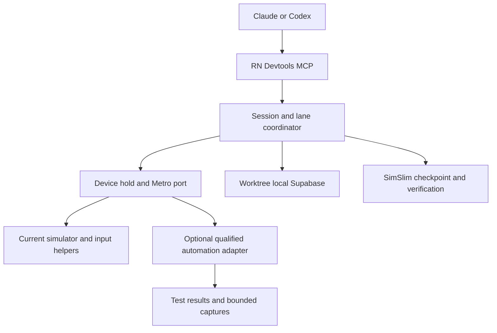

# Agent setup checks and simulator automation

Status: the initial agent configuration check and reversible repairs are
implemented locally on 2026-11-06; see [current behavior and limits](AGENT_SETUP_CHECK.md).
The 2026-11-05 investigation below is historical research. Automation-provider adapters
and comprehensive managed-policy/loaded-tool inspection remain proposals.

## Decision

Add one agent health service shared by onboarding, the persistent Agents view,
and `doctor`. Detect effective configuration and capability overlap, offer
specific reversible fixes, and verify the result after the client reloads.

Keep RN Devtools responsible for worktree/session identity, device holds, Metro
ports, local Supabase, and SimSlim. Evaluate other automation engines behind that
ownership boundary. Maestro is the first candidate for repeatable end-to-end
tests; Callstack agent-device is a candidate for native accessibility inspection.
Argent merits a comparison, but its proprietary native components require a
separate distribution decision. Do not replace the current input driver based
on feature lists or enable several independent default controllers.

## What the investigation established

The investigation compared a development setup's coding-agent configuration
with RN Devtools' setup and steering code. Its observations are restated here as
conditions any installation can present, without details of the machine
inspected.

| Observation | Implication |
| --- | --- |
| An RN Devtools MCP `doctor` call can succeed from a running coding-agent chat. | That proves MCP reachability from that chat. Agent configuration completeness is a separate check. |
| Another simulator controller can be enabled in the same Claude Code and Codex user configurations, and its skill can start an XCTest runner as soon as it connects. | Report confirmed capability overlap, not a claim that interference has occurred. |
| A client can have a working RN Devtools MCP registration but neither its PreToolUse/SessionEnd hooks nor the managed routing instruction block in its global or project instruction files. | Offer routing setup and hook verification; distinguish these from working MCP registration. |
| An Expo dev-client skill can recommend `simctl install booted` and manual Metro startup. | Flag conflicting instructions for review. Do not disable all Expo documentation. |
| An installed Maestro can predate 2.6.0, which introduced specific parallel iOS fixes; 2.12.1 was the current release at the time. | A dependency existing on PATH is insufficient; detect capability/version mismatch. No Maestro upgrade or device test was performed. |
| RN Devtools `elements` reads the connected React Native SDK's component inventory. | It does not provide a general native accessibility tree for arbitrary apps or system UI. That is a concrete reason to evaluate another backend. |

At the time of the investigation, setup ended with a direct desktop-socket doctor call. Its
`ok` records a successful response, while the desktop UI summarizes it as a
working connection. It does not inspect competing integrations or prove that a
fresh Claude/Codex session discovered the registered MCP. Source:
[`internal/app/setup.go`](../apps/desktop/native/rndevtools-cli/internal/app/setup.go)
and [`agent-cli-setup.ts`](../apps/desktop/src/main/agent-cli-setup.ts).

At the time of the investigation, the steering hook parsed only `tool_name: Bash` with
`tool_input.command`. Synthetic `exec_command` and competing MCP payloads pass
through. This is a parser limitation, not proof of the event shape emitted by
every Codex version. The client adapter needs version-specific fixtures and an
observed hook invocation before claiming coverage. Source:
[`internal/setup/hook.go`](../apps/desktop/native/rndevtools-cli/internal/setup/hook.go).

## Automation choices

| Component | Useful capability | Proposed role and qualification |
| --- | --- | --- |
| Current `simctl` + signed Swift input helper | Device/app lifecycle, captures, coordinate input and keys, with no additional runner installation | Retain as the baseline. Its private input interfaces need explicit Xcode/runtime regression tests. |
| Maestro | Accessibility selectors, waits/assertions, reusable YAML flows, reports and MCP interface | First optional test-runner adapter. Pin a qualified version, pass the lane's exact UDID, lease its driver port, and collect results through RN Devtools. |
| Callstack agent-device | Native accessibility snapshots, selectors, typed Node API, worktree sessions and device claims | Pilot for native inspection and agent interaction. Reconcile its claims with RN Devtools; it cannot independently choose/boot/release devices for a managed lane. |
| Software Mansion Argent | Native/React inspection, interaction, profiling and debugging | Benchmark candidate. Do not bundle its proprietary binaries under the assumption that the source license covers them. |
| Appium/XCUITest | Broad WebDriver automation and native device testing | Support as an optional explicit test workflow if needed. Isolate WDA/stream ports and DerivedData; do not add as a default startup dependency. |
| idb and MCP wrappers | Simulator control and inspection | No demonstrated advantage warrants another mandatory dependency. Evaluate for a specific missing capability, not simply because it exposes MCP. |
| SimSlim | Managed background-service reduction | Retain as a separate optimization layer. It does not replace input, native inspection, or a test runner. |

These are recommendations from source review, not comparative performance
results. Primary evidence:

- [Maestro MCP](https://docs.maestro.dev/get-started/maestro-mcp) exposes screen inspection and flow execution; its MCP is bundled with the CLI.
- [Maestro 2.6.0 notes](https://maestro.dev/blog/maestro-cli-v2-6-0) describe per-device session tracking, cross-process locking, port checks and `--driver-host-port` for parallel iOS execution. The [2.12.1 release](https://github.com/mobile-dev-inc/maestro/releases/tag/cli-2.12.1) is a candidate to qualify, not an already-supported RN Devtools version.
- [Maestro installation requirements](https://docs.maestro.dev/maestro-cli/how-to-install-maestro-cli) include Java 17+. This must appear as an optional runner prerequisite, not a requirement to start RN Devtools.
- [agent-device architecture](https://github.com/callstack/agent-device) describes a local accessibility bridge and XCTest interaction, plus its own worktree/device ownership. Its source is MIT licensed.
- [Argent README](https://github.com/software-mansion/argent#license) and [license additional terms](https://github.com/software-mansion/argent/blob/main/LICENSE.txt) distinguish Apache-licensed source from restricted simulator-server, ax-service and dylib redistribution. Treat external integration and redistribution as separate decisions.
- [Appium parallel testing](https://appium.github.io/appium-xcuitest-driver/latest/guides/parallel-tests/) requires unique UDIDs, WDA ports and DerivedData; streaming also needs a distinct MJPEG port. Its default WDA port, 8100, overlaps RN Devtools' default Metro range. Merely finding Appium installed is not proof of an active port collision.

### Integration boundary

An adapter receives a lane ID, exact UDID, selected app identity, lease revision,
leased auxiliary ports, deadline/cancellation signal and private artifact path.
The coordinator rechecks ownership at dispatch and retains exclusive mutation
access for the whole run. It must not hold a mutex and then call a public API
that tries to acquire the same mutex. Stop, release, app restart and SimSlim
reboots must cancel/join the runner before releasing its device.

A provider cannot fall back to `booted`, pick a new device, start Metro/Supabase,
apply slimming, kill global runners, or clear app data implicitly. Reject or
explicitly authorize flow operations that leave the selected target/scope. Stop
only the exact process/session started for the job. Do not silently switch
providers after a partly executed action; surface the last confirmed action.

Prefer the provider's supported CLI/API for a bounded integration. Wrapping its
entire MCP and re-exposing arbitrary tools is not required. RN Devtools remains
the agent-facing entry point. Provider diagnostics and outputs use the existing
redaction and output-size boundaries. Updates are pinned and qualified, rather
than fetched with `@latest` during a task.

## User experience

Add **Check agent setup** in the existing Coding agents setup card. Show separate
rows for selected clients, with the current project scope visible. Reuse the
same component in **Lanes → Agents → Agent setup checks** after onboarding. This is a narrow
RN Devtools compatibility feature, not a general plugin manager.

Example results:

| Finding | Explanation shown to the user | Actions |
| --- | --- | --- |
| Another simulator controller is enabled | SimView can drive devices outside RN Devtools' lane ownership. | Disable in this project / Choose scope / Keep enabled |
| Simulator instructions overlap | An Expo skill starts Metro and installs on an unspecified booted device. | Add RN Devtools routing / View instructions |
| RN Devtools connection needs repair | The registered executable is missing, disabled or points to an old install. | Repair connection / Recheck |
| Agent reload needed | Settings were updated; the current client may still expose the old tools. | Show reload steps / Verify connection |
| Hook coverage unverified | A hook is absent, not trusted, unsupported by this client version, or has not been observed. | Install supported hook / Show trust steps / Test |
| Optional runner needs an update | The selected runner lacks a required parallel-device capability. | Set up supported version / Use built-in controls |

Show only actions supported by that installed client/version. If a change can
only apply to every project, say **Disable for all Codex projects** rather than
presenting a project-scoped button. Do not ask the user to approve an opaque
"Fix everything" operation. A preview names the component, client, scope,
affected functionality and reload requirement; applying that preview is the
user's authorization. A successful write offers **Undo** and **Recheck**.

Track distinct results: **Configuration checked**, **Reload needed**, **Agent
connection verified**, and **Device test passed**. Read errors, unsupported
schemas and untrusted/remote scopes are **Not checked**, never a green result.
An intentionally disabled optional feature is **Not enabled**, not a failure.
Potential overlap is an advisory warning; block a lane only for an actual
ownership/resource conflict or a missing required capability.

## What to scan

Use bounded read-only adapters for known client inputs. Do not scan the entire
home directory or spawn every discovered MCP to learn what it does.

**Claude Code:** inspect user configuration, this project's local settings,
project `.mcp.json`, matching project entries in `.claude.json`, effective
plugin enablement and manifests, skill roots, instruction files and hooks.
Account for managed policy and configured alternate client roots. Identify
plugin-provided servers by their effective client ID, not just a display label.

**Codex:** inspect the effective user/project config layers, installed plugin
manifests and plugin-server policy, enabled tool filters, skill configuration,
instructions and hooks. Honor project trust and managed requirements. The
desktop/CLI share configuration, but may differ in loaded runtime state.

Claude Desktop has a separate configuration and should be a separate optional
adapter; success for Claude Code must not mark it verified. Remote clients and
other projects outside the selected scope remain explicitly uninspected.

Resolve symlinks with depth/size limits, deduplicate their canonical targets,
and preserve their provenance. Cache directories alone do not prove a plugin
is enabled or loaded. Read plugin inventory/active-install records before
choosing which cached version to examine. Read MCP launch signatures without
executing them or expanding shell expressions.

Each finding records a stable rule ID, rule version, client/version, project,
source kind/location, effective enablement (`yes/no/unknown`), capability,
severity, confidence, bounded redacted evidence, available fixes and freshness.
Never retain tokens, headers, environment values or raw whole-file snapshots
in a renderer/MCP/exported health report.

### Detection rules

- Known local simulator controllers: SimView, Argent, agent-device, Maestro, Radon, legacy simulator MCPs, `serve-sim`, and native automation wrappers. Check relevant tools and entry-point behavior, not just names. A tool called "connect" can install/start a runner.
- Overlapping lifecycle guidance: direct simulator mutation, implicit `booted` selection, manual Metro startup, and managed Supabase lifecycle commands. Text matching produces a review finding; quoted documentation is not itself an executable conflict.
- RN Devtools readiness: resolved signed executable, usable socket, required MCP tools, current skill versions, instruction precedence, supported hooks, client trust/reload state and session attribution.
- Shared-resource risks: observed port/process ownership and runners targeting an RN-managed UDID. Read bounded process identity, not environments. Do not kill anything while checking.
- Scope distinctions: Expo cloud/EAS tools and hosted Supabase tools are compatible; local Expo automation and unmanaged local backend lifecycle are potential overlaps. Xcode build diagnostics do not become conflicts merely by mentioning simulators.
- Existing disabled integrations: report as inactive or omit them from warnings. Unknown custom wrappers get review guidance, not an automatic disable action.

Use a shipped, versioned rule registry with documented evidence. A match must
say whether it is an enabled overlapping capability, an observed active
collision, or an uncertain instruction match. User exceptions are scoped to
the client/project/component fingerprint and reconsidered when that changes.

## Reversible repairs

Reuse the Go setup package's JSON/TOML handling and planning model. Extend it
with typed operations instead of arbitrary key/value patches from the renderer.

| Target | Repair mechanism |
| --- | --- |
| Direct Codex MCP | Set the exact server's `enabled = false`, preserving its definition and credentials. |
| Codex plugin MCP | Use `plugins.<plugin>.mcp_servers.<server>.enabled`; disable the whole plugin only when the user selects that scope or its instructions also need removal. |
| Claude Code MCP | Use the selected project's effective server disable setting; preserve the underlying registration. |
| Claude plugin | Use its supported scoped disable operation when disabling both tools and instructions is intended. |
| Conflicting skill | Prefer a supported per-skill disable or an explicit routing rule. Do not rewrite cached vendor skills or remove broad framework documentation. If the client cannot disable one member skill, show the real plugin-level consequence. |
| RN Devtools instructions/hooks | Install/update only marked RN Devtools content. Never silently trust a hook or overwrite unrelated user instructions. |

The adapter must follow the installed client's documented semantics. In
particular, Claude Code's `disabledMcpServers` is distinct from its project
MCP-approval lists. Codex supports both direct-server and plugin-server policy.
Sources: [Claude MCP disable behavior](https://code.claude.com/docs/en/mcp#disable-a-server-without-removing-it),
[Codex configuration reference](https://learn.chatgpt.com/docs/config-file/config-reference),
[Codex configuration precedence](https://learn.chatgpt.com/docs/config-file/config-basic),
and [plugin server policy](https://developers.openai.com/plugins/build/plugins).

A repair plan captures file fingerprints and affected values. Recheck them
immediately before applying; if another client changed the file, rescan and
regenerate the preview. Preserve unknown fields, comments/layout where
supported, permissions and symlinks. Managed/read-only configurations get
instructions rather than attempted privilege escalation.

Keep private recovery data with owner-only permissions; configuration backups
can contain credentials and must never enter exported diagnostics or Git.
Journal multi-file operations, report partial failure accurately, and validate
the resulting syntax/effective state. Undo restores only the touched values if
their current values still match the repair; it must not overwrite later edits.

A change on disk does not unload a running MCP or revoke a runner's existing
access. Keep **Reload needed** until the relevant client confirms the new tool
state. Stopping an external active runner is a separate, explicit action with
verified process ownership; do not hide it inside a configuration fix.

## Verification and when it runs

1. **Configuration check:** automatically before/after setup, after a repair,
   when opening a project, and on manual recheck. Debounce watches on known
   config/plugin/instruction inputs and revalidate after app focus or client
   version changes. Bound/cache the scan; no third-party process startup.
2. **RN Devtools connection check:** exercise the verified bundled MCP with
   `initialize`, `tools/list`, and `doctor`. This proves the server path and
   transport, not another client's loaded state.
3. **Client confirmation:** offer a copyable short verification prompt for the
   user's existing Claude/Codex chat. A short-lived check ID returned through a
   real RN Devtools tool call records reachability, client/session attribution
   and build. Do not silently create chats or incur model/cloud test costs.
   Client identity remains cooperative attribution, not authentication.
4. **Hook confirmation:** version-specific synthetic payload tests cover
   blocking decisions without executing the prohibited commands. An observed
   harmless invocation from the real client proves the hook was actually run.
   Keep installed, trusted and observed states separate; do not manufacture
   trust or claim MCP-wide blocking from a shell-only hook.
5. **Optional device test:** on an explicitly selected project and RN-owned
   test device, verify app connection, capture, controlled input, and backend
   access if enabled. Explain any app launch/build/test data before running.
   If no suitable free device exists, report that condition; never take one
   from another agent. A setup scan never launches this test automatically.

The extended doctor exposes these results independently, including timestamps
and coverage. A cached successful scan becomes stale when the executable,
client version, configuration, rules, or selected project changes. Read-only
checks may run automatically; external component disabling and device tests
remain explicit user actions.

## Original implementation plan (current delivery is documented separately)

- Add `internal/agenthealth` beside the Go `internal/setup` package for read-only client adapters, rules, findings and versioned reports. Reuse existing parsers; do not duplicate Codex TOML surgery in TypeScript.
- The local `rndevtools agent-check` now provides `scan`, `plan`, `apply`, `undo` and `probe`. Scans work with the desktop closed and never recursively call doctor. The explicit probe uses the bundled MCP connection.
- The Electron main process invokes the verified bundled CLI and projects bounded typed results. Extend the shared onboarding protocol and existing onboarding IPC to expose scan/preview/confirmed repair; use opaque finding/plan IDs, not arbitrary file paths or commands from the renderer.
- Extend `agent-cli-setup.ts` to preserve structured findings instead of reducing everything to `string[]`. Reuse the same result component from `setup-flow.tsx` and the persistent Agents view. Add a derived agent-check checklist item for selected clients.
- Add a bounded `agentSetup` section to the existing doctor result. The MCP can expose scanning/recommendations; it must not gain unrestricted client-configuration edits. Repairs go through the explicit desktop review path or the user's CLI invocation.
- Reuse `simulator-mutation-coordinator.ts`, the existing job lifecycle and cancellation, artifact handling and ownership checks for future provider adapters. Qualify Maestro first; do not replace this coordinator with a provider's independent device allocator.

## Acceptance tests and delivery order

**1. Detection and reporting.** Fixture tests for Claude/Codex configuration
precedence, project trust, plugin-server policy, disabled entries, aliases,
duplicate skills, symlink cycles, managed settings, unsupported schemas and
redaction. A generic Supabase/Expo documentation skill must not become a
confirmed controller conflict. Run the read-only scan on a development machine
whose client configuration is known, and compare its findings with that
configuration.

**2. Repairs and UI.** Exercise preview/apply/recheck/undo in temporary client
homes. Cover stale plans, concurrent writes, malformed input, read-only files,
mixed-user hooks, unknown fields, partial failure and interruption recovery.
Verify unrelated settings and credentials survive byte-for-byte where untouched.
Test keyboard navigation, scope labels, restart states and error recovery at
the desktop's minimum window size. Each workspace source change runs its
focused tests and quality gate.

**3. Actual client verification.** Test both Claude Code and Codex versions
against clean configurations and established configurations. Verify that the
chosen RN Devtools tools are exposed, disabled competing tools disappear after
reload, routing instructions load, and the real hook events are handled.
Synthetic payload tests alone cannot satisfy this gate.

**4. Optional automation qualification.** Compare the current driver, a pinned
Maestro version, agent-device and optionally Argent on the same dedicated test
app and devices. Measure cold/warm startup, action latency, failure/retry rates,
memory, leftover processes and cleanup. Include native alerts, text/keyboard,
scrolling, accessibility selectors and app restart. Run with SimSlim restored
and with the development profile, since extra runners may need services that
an optimization profile disables.

For every candidate, run two concurrent lanes with separate Metro/backend data
and unique auxiliary ports; test cancellation, provider crash, desktop restart,
foreign-agent refusal and one lane stopping without disturbing the other.
Require zero cross-device actions or cross-backend data reads. Report sample
counts and observed failures; do not advertise performance wins from a single
successful run. Admit a provider only after its ownership and cleanup behavior
passes, regardless of which one is fastest.

**5. Fresh Mac release qualification.** Use another physical Mac or a genuinely
fresh account with the downloaded packaged app, supported Xcode/runtime and
client versions. Verify installation, client discovery, configuration repair,
reload, basic input and the two-lane example. The example/native artifact must
be supplied through a versioned reproducible test fixture, not depend on a
developer's checkout, caches, PATH, credentials or signing installation. Keep
the existing stable toolchain and the currently tested Xcode 27.1/iOS 27 tuple
as separate matrix entries. Scope unsupported hardware/features explicitly.

The investigation verifies the problem and the integration seams. It does not
yet qualify any replacement automation engine, ship the proposed health UI,
or establish second-Mac reliability.
